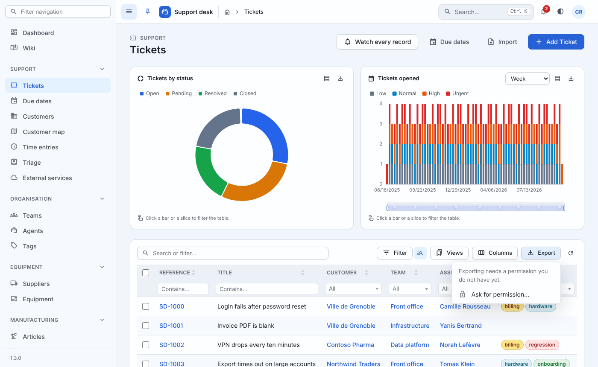
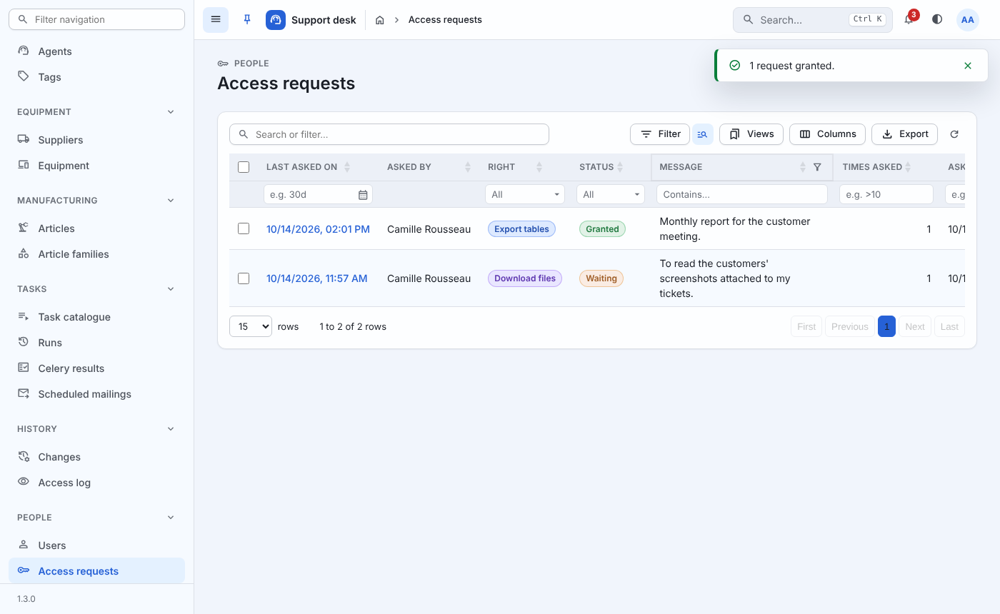
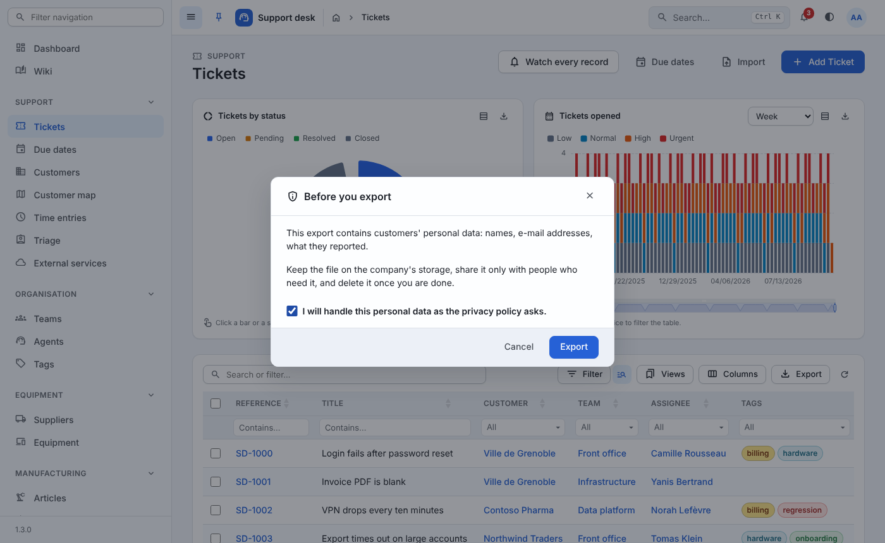

# Rights given on request

By default, whoever may read a list exports it, and whoever may read a
record downloads its files. Some data should not leave the application
that easily: a project can make either right one that people **ask
for**, and that an administrator **grants**.

```python
GENERIC = {
    "ACCESS_ON_REQUEST": ("export", "download"),
}
```

Each right named becomes a permission, checked on every request:

| Right | Permission | What it covers |
| --- | --- | --- |
| `export` | `generic.export_rows` | Every table's Excel and CSV exports (resources, `DataResource`, `DataTableView`, related tables, flat trees), the menu's copy and print, and scheduled mailings |
| `download` | `generic.download_files` | Every record's files (`api/<app>/<model>/<pk>/files/<field>/`) and the wiki's attached files |

Superusers hold both, as they hold every permission. The permissions
are given like any other - to a person, or to a group on *People ›
Groups* - or by granting a request. Taking one away is taking the
permission away on the person's or the group's page.

Nothing changes for a project that leaves `ACCESS_ON_REQUEST` empty.



## Asking

Somebody without the right finds, where the export menu's files would
be, *Ask for permission…*; and beside a file on a record's page, where
its link would be, *Ask to download*. Their account page has a
*Permissions on request* section listing each right, held or not, the
request waiting, and a button to ask - or to remind.

Asking opens a short form: why they need it (optional). The request
records who asked, for what, the page they were on and their message.

Asking again while the request waits **reminds** the people who decide
- the same request, its count of times asked going up - but no more
than once an `ACCESS_REQUEST_INTERVAL` (an hour by default). Within the
hour the answer is a kind *From 14:32, you can remind the
administrators*, and nobody is notified. After a refusal, a new request may be
made once the same interval has passed.

## Deciding

Every request reaches, as a notification and an e-mail
(`ACCESS_REQUEST_CHANNELS`), every active **superuser** and everyone
holding **`generic.validate_accessrequest`** - directly or through a
group. The notification leads to the request's page.

The *People › Access requests* screen lists every request, waiting or
decided, at any time: who asked, for what, their message, how many
times, when, and who decided. The *Waiting* preset shows what is left
to do. *Grant* gives the person the permission and tells them; *Refuse*
tells them too. Both are bulk actions, from the list or a request's
page. Nobody decides on their own request, and a decided request stays
decided.

The screen opens to `generic.validate_accessrequest` (read and decide)
and to `generic.view_accessrequest` (read only); requests are never
written in a form.



## A reminder before exporting or downloading

Apart from who may, a project can show a reminder - a privacy notice,
most often - with a box to tick before every export and every
download. Off by default; a text turns it on:

```python
from django.utils.translation import gettext_lazy as _

GENERIC = {
    "EXPORT_DISCLAIMER": {
        "title": _("Personal data"),          # optional
        "text": _("This export contains customers' personal data..."),
        "checkbox": _("I will handle it as the privacy policy asks."),
    },
    "DOWNLOAD_DISCLAIMER": _("Files may hold personal data..."),
}
```

A plain text gets a title (*Before you export*, *Before you
download*) and a box (*I have read this reminder...*) of its own; a
blank line starts a new paragraph. `gettext_lazy` texts are shown in
each reader's language. The *Export* or *Download* button stays
disabled until the box is ticked.

`EXPORT_DISCLAIMER` comes before the menu's Excel, CSV, copy and
print, and before *Send by e-mail on a schedule*;
`DOWNLOAD_DISCLAIMER` before every link to a file the framework
serves - a record's (summary page, table cells, a project's own
icons) or the wiki's. Either works with or without
`ACCESS_ON_REQUEST`. It is a reminder, not a lock: the endpoints do
not ask for the tick, and a script with a token downloads as before.
`Generic.access.confirm(kind)` shows it from a page of the project's
own.



## From code

```python
from generic import grants

grants.may(request, "export")        # the rule every export obeys
grants.may(user, "download")         # a user works too

access_request, created = grants.ask(
    user, "download", message="For the audit", page="/contracts/"
)  # raises grants.TooSoon(retry_at), grants.AlreadyHeld

grants.grant(access_request, by=admin)
grants.refuse(access_request, by=admin)
grants.validators()                  # who is told
```

`ExportMixin.check_export_permission(request)` is where a table's
endpoint refuses; a viewset of the project's own built on
`DataTableViewSet` obeys it with nothing to write.

## The API

| Endpoint | |
| --- | --- |
| `GET api/generic/access-requests/` | `{"rights": [{"kind", "label", "held", "status", "askedAt", "retryAt"}]}` for the signed-in person |
| `POST api/generic/access-requests/` | `{"kind", "message", "page"}`: `201` a new request, `200` a reminder, `429` too soon (`retryAt`), `400` held already or not given on request |

Pages know, from `Generic.config().access` (`{"url", "missing": [...]}`),
which rights given on request their reader lacks; `Generic.access.missing(kind)`
and `Generic.access.ask(kind)` are what the export menu and the
record's page use, and what a page of the project's own can use too.
The server checks every export and every download anyway: the
interface only says what to offer.

## Settings

| Setting | Default | Meaning |
| --- | --- | --- |
| `ACCESS_ON_REQUEST` | `()` | Rights given on request: `"export"`, `"download"` |
| `ACCESS_REQUEST_INTERVAL` | `3600` | Seconds before asking again reminds anyone, or a refused right may be asked anew |
| `ACCESS_REQUEST_CHANNELS` | `("notification", "mail")` | How the people who decide, then the person who asked, are told |
| `EXPORT_DISCLAIMER` | `None` | A reminder ticked before every export: a text, or `{"text", "title", "checkbox"}` |
| `DOWNLOAD_DISCLAIMER` | `None` | The same, before every file download |

Migration `generic 0021`.
