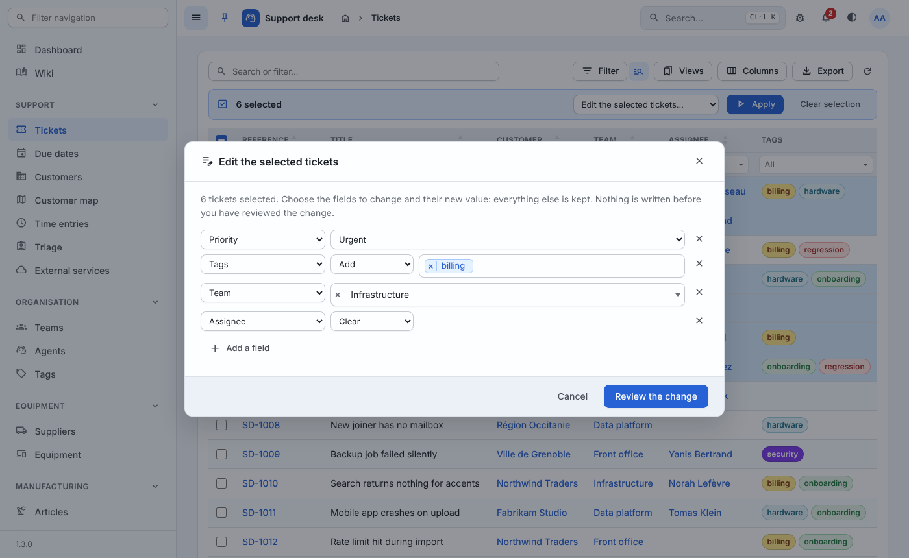
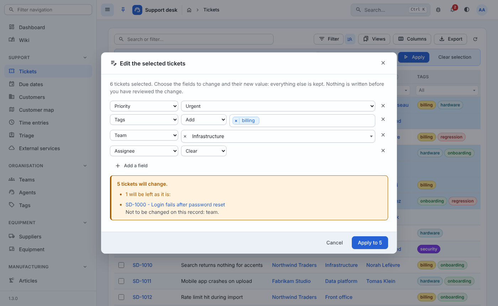

# Bulk edit

Forty tickets to move to another team, a dozen to tag *billing*, a
week of due dates to clear: a selection of rows given one value per
field, from the list itself.

```python
@register(Ticket)
class TicketResource(ModelResource):
    bulk_edit_fields = ("team", "assignee", "customer", "priority",
                        "tags", "is_billable", "due_on")
```

That is the whole declaration. The list's selection bar then offers
**Edit the selected tickets…** first in its action menu, to readers who
may change tickets.



## What the reader does

1. Tick rows in the table — or tick the page and *Select all N
   matching rows*: the selection is then every row the filters and the
   search match, on every page.
2. Choose **Edit the selected …** in the selection bar, then *Apply*.
3. In the dialog, add a line per field to change: the field, what to do
   to it, the value. The value is entered in the control the form uses
   for that field - a select for a choice, an autocomplete for a
   relation, a date box, a switch. Fields not added keep their values.
4. **Review the change.** Nothing is written yet: the server runs the
   whole edit and rolls it back, and the dialog says how many records
   would change, how many already hold these values, and which would be
   left as they are, and why.
5. **Apply to N.** The records are written; a report names any left as
   they were. Changing anything in the dialog after the review asks for
   a new one.



What may be done to a field depends on the field:

| Field | Modes |
| --- | --- |
| Any | *Set to* a value |
| Optional (`null=True`, or `blank=True` text) | *Clear* as well |
| Many-to-many | *Add* (to each record's own values), *Remove* (from them), *Set to* (replace them), *Clear* when `blank=True` |

Adding is what one usually means by tagging a selection: each ticket
keeps its other tags.

## What it guarantees

- **Each record is edited as its form edits it.** The resource's own
  form serializer validates it - partially, only the chosen fields -
  and `save_bulk_edit` writes it (`save_model(request, serializer,
  change=True)` by default). A bulk edit refuses what the form refuses,
  stamps what the form stamps (an author in `save_model`), and narrows
  relations as the form does (`team_field`, `scope_relations`). It is
  never a way round a rule.
- **Permissions are each record's.** The endpoint asks
  `has_change_permission(request)` before anything; then, per record,
  `has_change_permission(request, obj)` and `can_edit_column(request,
  field, obj)` - the same per-record rule an editable table follows.
  A record that fails either is left as it was and named, never
  half-written. The selection is always read within `get_queryset(request)`:
  a key the reader may not see is simply not selected.
- **Nothing happens unseen.** The review is the same work as the write,
  rolled back - so what it announces is what the write does, unless
  the records changed in between, which the final report then says.
- **It is remembered.** One history version per changed record, by
  the reader - in the record's *History* tab - with the source
  `Bulk edit: <fields>`, a column of *History › Changes*; one live
  `bulk` event for the open tables (`realtime.batch`); watchers are
  told of each record. A record already holding the values is not
  saved at all.
- **It can be taken back.** The report of an applied edit ends on an
  *Undo* button: every record put back as it was before, unless one
  was changed since ([Undo](undo.md)).
- **It has a size.** `GENERIC["BULK_EDIT_MAX_ROWS"]` (1000) records at
  most; a larger selection is refused with a request to narrow it with
  the filters first.

## Choosing the fields

`bulk_edit_fields` names fields of the model **on its form**, writable
there. Refused when the resource is registered
(`ImproperlyConfigured`), with a sentence saying why:

- a name that is not a field, or a reverse relation (edit it from the
  other side);
- a unique field or the primary key: two records could never share it;
- a file field: a file is chosen on a record's form;
- a state field of `transitions`: its transitions are bulk actions
  already, and the only way it moves;
- a field in `readonly_fields`, or not in the form's fields.

What a selection shares is what *sorts* records - a team, an owner, a
priority, a status-like choice, tags, a flag, a date - rather than what
*names* them. Free text can be declared (a note to every record) but is
rarely what a bulk edit is for.

`auto()` and `AutoResource` work the fields out where none are
declared: every field on the form with choices, every boolean, foreign
key, many-to-many and date, never a unique one. `bulk_edit_fields = ()`
turns it off.

## Reprogramming the write

```python
class TicketResource(ModelResource):
    def can_edit_column(self, request, column, obj=None):
        # A closed ticket stays with the team that closed it - in the
        # grids, and in a bulk edit, which names it and goes on.
        if column == "team" and obj is not None and obj.status == "closed":
            return False

        return super().can_edit_column(request, column, obj)

    def save_bulk_edit(self, request, serializer, obj):
        if obj.is_frozen:
            raise ValidationError(gettext("Frozen by the auditors."))

        return super().save_bulk_edit(request, serializer, obj)
```

A `ValidationError` (DRF's or Django's) or an `IntegrityError` raised
while one record is written rolls that record back - a savepoint each -
and names it in the answer; the others are written.

| Hook | Default | Use it to |
| --- | --- | --- |
| `can_bulk_edit(request)` | fields declared and `has_change_permission(request)` | offer it to fewer readers |
| `can_edit_column(request, field, obj)` | True | freeze a field on some records (shared with editable tables) |
| `save_bulk_edit(request, serializer, obj)` | `save_model(..., change=True)` | refuse on a rule, or do more |
| `get_bulk_edit_options(request)` | `{"url", "label"}` or `{}` | another label |

## The endpoint

`GET api/<app>/<model>/bulk-edit/` - the dialog's fields, as the form
schema describes them (`autocompleteUrl`, `choices`, `type`...), each
with `modes`; `maxRows`; `name`, `namePlural`.

`POST api/<app>/<model>/bulk-edit/`:

```json
{
  "ids": ["12", "14"],
  "changes": {
    "priority": {"mode": "set", "value": "urgent"},
    "tags": {"mode": "add", "value": [3]},
    "assignee": {"mode": "clear"}
  },
  "commit": false
}
```

The selection is the actions endpoint's: `ids`, or `"all": true` with
the table's filter parameters (`filters`, `search[value]`, `_related`,
`_grid`) in the query string. Without `"commit": true` it is the
review. The answer:

```json
{
  "counts": {"selected": 3, "changed": 2, "unchanged": 0,
             "refused": 1, "invalid": 0},
  "committed": true,
  "problems": [{"id": "14", "label": "SD-3 - Invoice export is slow",
                "url": "/example/ticket/14/", "status": "refused",
                "messages": ["Not to be changed on this record: team."]}],
  "moreProblems": false,
  "message": "2 tickets changed.",
  "level": "warning",
  "operation": {"report": [...]}
}
```

`problems` names 50 records at most (`moreProblems`). Once written, the
answer carries an operation's report (`Generic.operations.handle` draws
it, [Operations](operations.md)). Refused: 403 for a reader who may not
change the model or a resource declaring nothing, 400 for an empty or
undeclared change, a mode the field does not take, nothing selected, or
more than `BULK_EDIT_MAX_ROWS`; 404 in the trash.

## In the browser

`js/bulk_edit.js` (`Generic.bulkEdit.open({url, body, count, title})`,
loaded by `generic/datatable.html`) builds the dialog from the endpoint
with `Generic.forms.widgets` - the form's own controls, Select2 hung
inside the dialog. `js/datatables/selection.js` puts the entry first in
the selection bar (option `bulkEdit` of the table) for every table of
the resource: its list, its related tables on other records' pages, its
grids - the trash's excepted.

## In the example

*Support › Tickets*: tick a few tickets, *Edit the selected tickets…*,
*Apply*. Add *Priority › Set to › Urgent*, *Tags › Add › billing*,
*Assignee › Clear*, then *Review the change*. Include a closed ticket
and change the *Team*: the review names it - a closed ticket stays with
its team (`TicketResource.can_edit_column`). *Equipment* has it worked
out by `auto()`.
