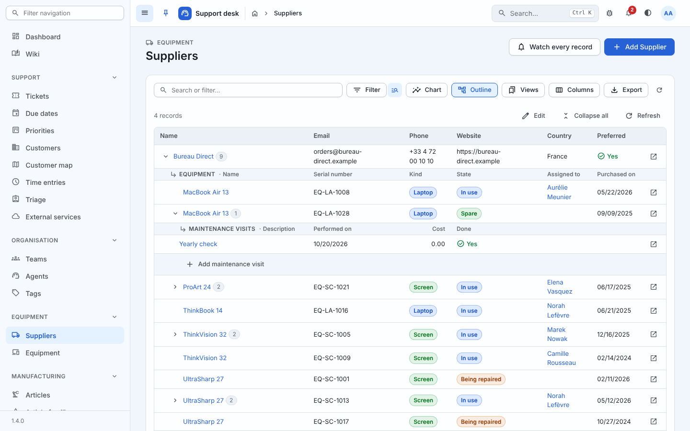

# Outlines

A supplier, the equipment bought from it, the maintenance visits of
each piece: three tables, three pages. Or one view, where each supplier
has an arrow to its equipment and each piece of equipment an arrow to
its visits, every level corrected where it stands.

An outline is declared on the resource of the top level, by the
relations to walk down. The list page then gets an **Outline** button
in its table's toolbar: pressed, the table's rows make way for the
outline, drawn like a [tree](trees.md), and the table's search, filters
and order still choose its first level.

```python
from generic.sites import auto

# Each name is a relation of the level above: suppliers > equipment >
# maintenance visits.
auto(Supplier, related=("equipment",), outline=("equipment", "maintenances"))
```

```python
from generic.sites import Level, ModelResource, Outline, register

@register(Customer)
class CustomerResource(ModelResource):
    list_display = ("name", "segment", "account_manager", "ticket_count")
    outline = Outline(
        Level("tickets", columns=("reference", "title", "assignee", "priority")),
        Level("time_entries", columns=("spent_on", "agent", "hours", "note")),
        title=_("Tickets and time"),
        columns=("name", "segment", "account_manager", "ticket_count"),
    )
```



## What it shows

- **The first level is the table's rows.** The same search box, filter
  chips, presets and order: change them and the outline follows. The
  count above it is the table's.
- **Each record has an arrow to its records of the next level**, and
  their number beside its name. Nothing is fetched before it is
  unfolded: a level is one request, the first `page_size` records (25)
  with *Show more* for the next ones, so a supplier with a thousand
  pieces of equipment opens as fast as one with three.
- **Each level is drawn with its own resource's columns**, with the
  renderers of its own table - tags, dates, yes and no, links to the
  records a row points at. A heading row names the level and its
  columns above its first record; the first column sits beside the
  arrow, and links to the record's page. The icon at the end of each
  row opens it too.
- **Under each unfolded level, *Add …***, when the level is reached by
  a foreign key and the reader may add its records: the add form, the
  parent filled in, back to the list once saved.
- **Kept**: the outline is remembered for the table (in the browser,
  and in the address as `?outline=1`, so a link opens it). *Collapse
  all* folds everything, *Refresh* reads every open level again; a
  record changed elsewhere refreshes the levels open on screen (live
  updates), unless the reader is in the middle of typing.
- **The keyboard** walks it as it walks a tree: up and down, right to
  unfold, left to fold or go up, Enter to open the record.

## Editing in place

The outline has an **Edit** button when some of its cells may be
written by this reader. Pressed, every such cell becomes its control,
written as a [grid](editable.md) writes it:

- which cells: the level resource's `editable_fields` among the
  columns shown, and only those this reader may change - the
  resource's change permission, `field_permissions`, `can_edit_column`;
- how: the control the form would have used, one `PATCH
  api/<app>/<model>/<pk>/cells/` a cell, through the level resource's
  `save_editable` - validated by its form serializer, refused under the
  cell with the reason;
- the answer is the whole row, which updates the cells around it.

*Stop editing* puts the values back. A page opened as the list's grid
(`?edit=1`, below) opens its outline in edit mode too.

A long text is a textarea in its cell, written when it is left, and as
tall as what it holds plus one line to write on: one line when empty,
two for a line of text, three for two - lines the cell's width wraps
count too. A level
that names no columns shows its long texts after its visible columns -
with `auto()`, a model's `TextField`s are in its list, hidden at first,
so a comment's body is there and written in place with nothing
declared. In edit mode, the icon at the end of a row turns into a
pencil, *Edit in a dialog* - as does a record's name when it is not a
control itself - and opens its **whole form in a dialog** over the
outline, for what its row does not
show: a text the list leaves out, its own inlines, its files. Saved
there, its level is read again; the outline stays where it was. The
dialog is the form's popup (`?_popup=1`), the one a relation's pencil
opens, in a frame of the page: offered to readers with the change
permission on the level's model. That popup answers
`X-Frame-Options: SAMEORIGIN`, and `Content-Security-Policy:
frame-ancestors 'self'` when the site sends no policy of its own - the
browser reads that one first, so a second `X-Frame-Options` added in
front of Django (a proxy, a middleware: *conflicting values, falling
back to deny*) does not refuse it. A frame refused all the same opens
the form in a window of its own instead, which answers the outline the
same way.

The rows alternate their colour as a table's do, counted down the
page whatever their level.

`auto()` works `editable_fields` out (see below), so an `auto` outline
is editable without a word more. On a hand-declared resource the
levels are as editable as their resources say.
`Outline(..., editable=False)`, or `Level(..., editable=False)` for one
level, reads only.

## Putting records in order

Records that keep an order of their own among their parent's - the
comments of a ticket, the lines of a bill of materials - are dragged
into another, in edit mode, by the handle before their first column (or
moved with Alt and the up and down arrows). The order is an integer
field of the application's model:

```python
class TicketComment(models.Model):
    ticket = models.ForeignKey(Ticket, related_name="comments", ...)
    body = models.TextField()
    position = models.PositiveIntegerField(default=0)

    class Meta:
        ordering = ("position", "pk")
```

Nothing more to declare: a level whose ordering starts with an
ascending integer field - its resource's `ordering`, else the model's,
the key back up to the parent aside - is put in order by it.
`Level("comments", position="rank")` names another field,
`position=False` keeps the level as it is. Only a level reached by a
foreign key: a record shared by several parents has no place of its
own among one's.

A move writes the positions the parent's records already had, given out
again in the new order (1, 2, 3... when some were shared), and only
those whose place changed - each one saved, so history and live updates
follow, and each one asked to the level's resource: the change
permission on the record, the field neither read only nor locked by
`field_permissions`. A position unique among a parent's records is
fine: the records moved step out of the way first.

`POST api/<app>/<model>/outline/move/` with `{"level": 1, "parent":
<key>, "id": <key>, "before": <key>}` (or `"after"`, or neither for
last) answers the new order.

## Declaring it

`outline` on a resource takes relation names - a tuple, or one name -
or an `Outline`:

| `Outline(...)` | Default | Means |
| --- | --- | --- |
| `*levels` | | the levels below the top, in order: relation names, or `Level(...)` |
| `title` | "Outline" | the button's label and the outline's name |
| `columns` | the list's visible columns | the top level's columns, by name |
| `page_size` | `25` | records per request when a level unfolds (1 to 200) |
| `editable` | `True` | `False`: nothing edited at any level |
| `max_columns` | `6` | columns a level shows at most, when none are named |
| `icon` | `account_tree` | the button's icon |

| `Level(...)` | Default | Means |
| --- | --- | --- |
| `name` | | the relation reaching the level from the level above |
| `columns` | the level's visible list columns, without the one pointing back up, then its long texts hidden in the list | its columns, by their names in the level resource's `list_display`; the first beside the arrow |
| `title` | the model's plural name | the heading above its records |
| `editable` | `True` | `False`: this level read only |
| `position` | the integer field its ordering starts with | the field keeping the records in order among their parent's, dragged in edit mode; `False`: none |

A name is what `related` takes ([auto](auto.md#related-rows-the-one-thing-to-say)):
a reverse foreign key's `related_name` or a many-to-many, either side.
Five levels at most below the top.

Checked at registration: each name must be a relation of the model
above holding several records - a misspelt one names the relations
there are. The levels' resources may be registered later: a level
whose model is not registered, or a column its list does not have,
raises `ImproperlyConfigured` when the outline is first drawn. With
`auto()`, the models of the levels nobody registered get pages worked
out from them, out of the navigation, as `related` models do.

## Who sees what

- Each level's records come from **its resource's** `get_queryset(request)`:
  its teams, its trash, its own rules - never a record its list would
  not show.
- The outline goes **as far down as the reader may view**: without the
  view permission on the visit model, the equipment has no arrow, and
  its endpoint answers 404 for that level. With nothing to unfold below
  the top, there is no button.
- Columns are each level's table columns as **this reader** sees them
  (`field_permissions`).
- Writing asks each record's resource, as any grid does; the endpoint
  checks again.

## The endpoint

`GET api/<app>/<model>/outline/` - one page of one level:

| Parameter | |
| --- | --- |
| `level` | `0`, the top (default), to the last level |
| `parent` | below the top: the key of the record unfolded, a record of the level above |
| `offset`, `limit` | the page (`limit` ≤ 200, default `page_size`) |
| `filters`, `search`, `ordering` | the top level: the table's, applied by its own backends |

```json
{"level": 1, "total": 9, "offset": 0, "limit": 25,
 "items": [{"id": "12", "url": "/example/equipment/12/", "children": 2,
            "row": {"_pk": 12, "name": "MacBook Air 13", "kind": "laptop", "...": "..."}}]}
```

Each `row` is the level resource's own table row - what its renderers
and its cells read; `children` counts the records of the next level the
reader may see. 404 for a level the reader may not view, a parent they
may not see, or a list without an outline; 400 for a parameter that is
not a number or a missing `parent`.

## On a record's page

A record's tab of related rows ([`RelatedTable`](sites.md)) gets the
same **Outline** button, its first level being the tab's rows - the
record's - and every level below editable as on the list:

```python
class TeamResource(ModelResource):
    related_tables = (
        # Each of the team's tickets unfolds into its time entries.
        RelatedTable("tickets", outline=("time_entries",)),
    )
```

`outline` takes what a resource's does (names, or `Outline(...)`),
walked down from the related model; `False` offers no button. Left out,
the tab finds it by itself:

1. **The record's own outline, below this relation.** A supplier's
   outline is `("equipment", "maintenances")`: on a supplier's page,
   the *Equipment* tab unfolds into the visits, with the columns the
   outline gives them. Nothing to declare - `auto` included.
2. **Else the related resource's outline**, if it declares one.

The column pointing back at the record is left out of the first level,
as the tab leaves it out of its table. *Add ...* comes back to the
record's page, on the tab. The choice is remembered per tab, not in the
page's address, which several tabs share. The endpoint is the related
resource's `outline/`, with the tab's `_related` parameter: the first
level is the record's rows, and the levels below those of that tab's
outline. A misspelt level is refused when the related tables are first
resolved.

## The list's own Edit button

A list may also be corrected where it is, as a [grid](editable.md):
`list_editable = "toggle"` keeps the list a list and puts an **Edit**
button in its toolbar. Pressed, the page comes back as the grid of the
resource's `editable_fields` (`?edit=1`, the filters kept); *Stop
editing* brings the list back. The button is there for readers who may
write at least one of those cells.

`auto()` declares it: it works out `editable_fields` - the list's
columns that are the model's own fields on its form, never a file, a
key, a read-only field or a state field - and sets `list_editable =
"toggle"`. Both are declarations like any other: `auto(Supplier,
editable_fields=("country",))`, or `list_editable=False` for no button.

## In the example

- *Suppliers* (`auto`): the outline unfolds into equipment, then
  maintenance visits, every level editable; *Edit* turns the list into
  its grid.
- A supplier's page: its *Equipment* tab unfolds into the visits (the
  supplier's outline, below the equipment). A customer's *Tickets* tab
  into their time entries; a team's *Tickets* tab too, declared on the
  tab (`RelatedTable("tickets", outline=("time_entries",))`).
- *Tickets* (by hand): *Conversation* unfolds each ticket into its
  comments, their text written in place, dragged into another order
  (`TicketComment.position`), each one opened in a dialog.
- *Customers* (by hand): *Tickets and time* unfolds into each
  customer's tickets, then their time entries, with the columns named
  per level; the ticket's assignee, priority and due date and the time
  entry's date, agent, hours and note are the editable ones - what
  those resources declare.
