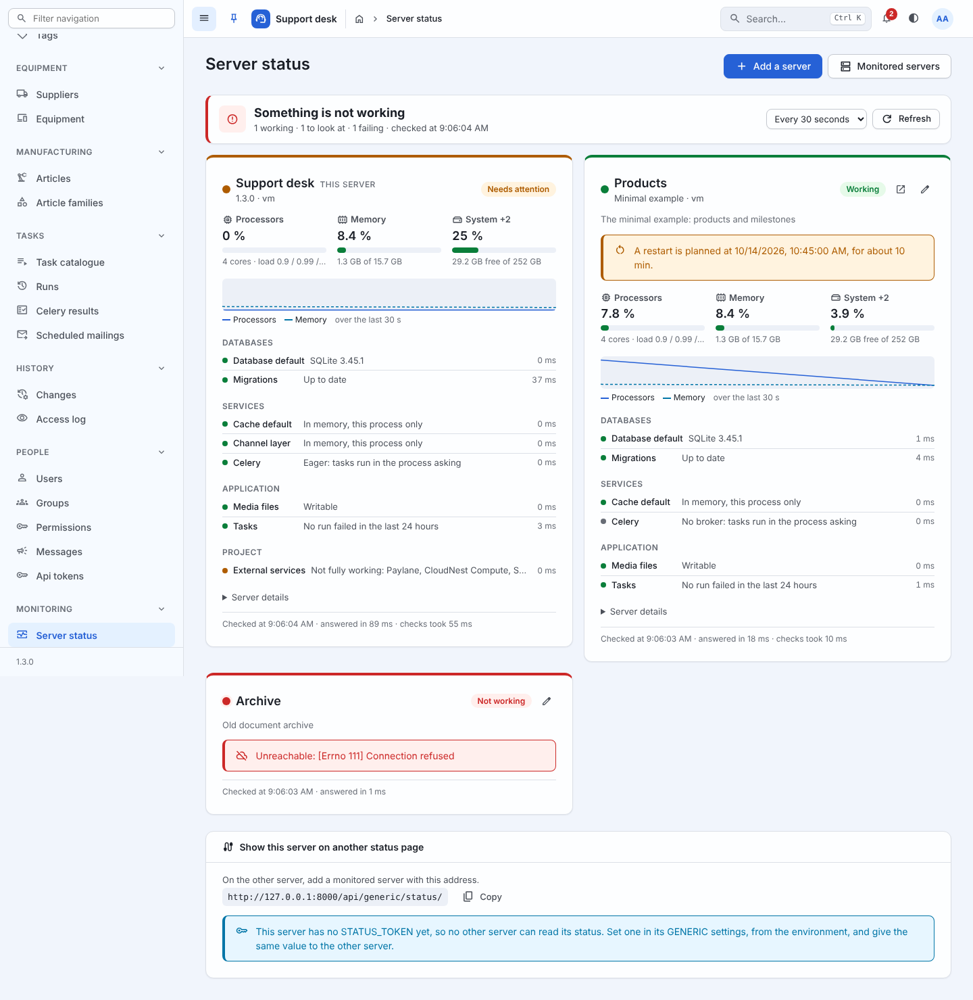

# Server status

One page says whether the application is working, and why not: how busy
the processors are, how much memory and disk is left, whether every
database, cache and service answers - for this server and for every
other server running django-generic that it is told about. One
maintenance server can watch all the others from the same page.



```
Server status
  Every server is working  -  3 working, checked at 10:42:07     [Every 30 seconds] [Refresh]

  Support desk (this server)   Working     Products                  Working     Archive         Not working
  Processors 12 %  Memory 41 %             Processors 3 %  Memory 22 %           Unreachable: Connection refused
  System 63 %      Media files 63 %        A restart is planned at 14:00
  Databases  default  PostgreSQL 16.4      Databases ...
  Services   cache, channel layer, Celery  ...
  Project    External services: Paylane degraded
```

## The page

*Monitoring › Server status*, for anyone holding `generic.view_status`
(*Can view the server status*, a permission of the framework given like
any other). It opens on a line saying, in one word, how all the servers
are, then a card per server:

| Part of a card | Says |
| --- | --- |
| **The dot and the badge** | *Working*, *Needs attention* or *Not working*: the worst of the server's checks and gauges |
| **Gauges** | Processors (with the load average), memory, swap when there is some, and each disk - green, then orange, then red, at the thresholds |
| **Trend** | Processors and memory since the page was opened, a line each |
| **A planned restart** | When one is announced on that server ([Planned restarts](maintenance.md)) |
| **Checks** | Each check, grouped - databases, services, application, project - with what it found and how long it took |
| **Server details** | Host, system, uptime of the machine and of the application, process, Python, Django, django-generic, time zone, debug mode, accounts, people signed in today, open sessions |
| **Footer** | When it was checked, how long the server took to answer, how long its checks took |

The page asks every server again at the pace its reader picks - every
10 or 30 seconds, every minute, every 5 minutes, or not at all
(`STATUS_REFRESH_SECONDS` is the default) - and stops asking while it
is hidden in another tab. Each server is asked on its own, so one that
takes its time holds up its own card only.

A status is a sample, not an event: nothing happens when a disk fills
up a little more, so there is nothing to push over the WebSocket. This
page is the one place the framework asks again on a timer, and it does
so only while somebody is looking.

## The checks

The framework's own, on every server:

| Check | Fine when | Otherwise |
| --- | --- | --- |
| **Database** *alias*, each of `DATABASES` | a query answers - `SELECT 1` (`FROM DUAL` on Oracle), SOQL on `Organization` for Salesforce, or the project's (`STATUS_DATABASE_QUERIES`); says the engine and, when the backend tells, its version | error |
| **Migrations** | none is left to apply | warning, with how many |
| **Cache** *alias*, each of `CACHES` | a value written is read back | error; *off* for the dummy cache |
| **Channel layer** | a message sent to a new channel comes back (in memory: says so) | error; *off* without one |
| **Celery** | the broker answers, and how many workers do | warning when no worker answers; *off* without a broker; eager says so |
| **Media files** | `MEDIA_ROOT` exists and can be written | error |
| **Tasks** | no task run failed in the last 24 hours | warning, with how many |

A database whose backend speaks no plain SQL is asked in its own
language: django-salesforce gets `SELECT Id FROM Organization LIMIT 1`.
Any other gets its query from the settings, and `None` leaves it out:

```python
GENERIC = {
    "STATUS_DATABASE_QUERIES": {
        "legacy": "SELECT 1 FROM sysibm.sysdummy1",   # DB2
        "archive": None,                                # not checked
    }
}
```

*Off* means not in use here: it is drawn grey and never makes a server
fail.

### Checks of the project's own

```python
# myapp/resources.py - or any module imported at start-up
import requests
from django.utils.translation import gettext_lazy as _
from generic.status import register_check


@register_check(label=_("Payment provider"))
def payments():
    response = requests.get("https://pay.example.com/health", timeout=3)

    if response.status_code != 200:
        return "error", f"HTTP {response.status_code}"

    return "ok", _("Answered")
```

What a check returns says how it went:

| Returns | Means |
| --- | --- |
| `None`, `True`, `"ok"` | fine |
| `False` | broken |
| `"warning"`, `"error"`, `"off"` | that level |
| `"some text"` | fine, with that detail |
| `(level, detail)` or `{"level": ..., "detail": ...}` | both |
| raises | broken, the exception's message as the detail (logged as a warning) |

`register_check(name=..., label=..., group=...)`: the name defaults to
the function's import path, and declaring the same name again replaces
the check; the group defaults to *Project*. A check runs on every
refresh of every page showing the server: keep it quick, and give
whatever it asks a timeout. The same thing from the settings:
`GENERIC["STATUS_CHECKS"] = ["myapp.status.payments"]`.

The example declares one, *External services*, in
`example/resources.py`: a warning while a critical service of its status
API is not operational.

## Watching other servers

Every server answers the same JSON document at `api/generic/status/`,
and another one only needs its address to show it. On the server to be
watched, set a token:

```python
# settings.py, the server being watched
GENERIC = {"STATUS_TOKEN": env("DJANGO_STATUS_TOKEN")}
```

On the maintenance server, *Monitoring › Monitored servers › Add*:

| Field | |
| --- | --- |
| **Name** | What the card is called |
| **Address** | The other site (`https://erp.example.com`): the usual endpoint, `api/generic/status/`, is added to it. A project mounting `generic.urls` elsewhere gives the endpoint itself - its own status page shows the address to copy, under *Show this server on another status page* |
| **Token** | The other server's `STATUS_TOKEN`. Write only: never shown again, never in the history or an export; left empty on a change, the current one stays |
| **Description**, **Shown**, **Position** | A line under the name; untick to keep the server without asking it; the order of the cards |

*Test the connection*, a bulk action of the list, asks the selected
servers at once and reports how each answered - or why not: refused
(the token), not found (the address), unreachable, too slow, or an
answer that is not a status.

The request goes from the maintenance server, never from the browser:
the token stays on the server, and the other site needs no CORS rule.
It sends the token in the `X-Generic-Status-Token` header, waits
`STATUS_REMOTE_TIMEOUT` seconds, follows no redirection (the token is
not sent anywhere else: the card says where it was redirected), and
reads 2 MB at most. A server shows its own status only, never the
servers it watches, so two servers watching each other is not a loop.

### Who may read a status

| Endpoint | Answers |
| --- | --- |
| `GET api/generic/status/` | this server's status, to a signed-in reader holding `generic.view_status`, or to a request sending one of `STATUS_TOKEN` in `X-Generic-Status-Token` (compared in constant time); 401 to nobody, 403 to anyone else |
| `GET api/generic/status/servers/<pk>/` | a monitored server's card, asked from here, for `generic.view_status` |
| `GET api/generic/status/health/` | `{"level": "ok"}`, `"warning"` or `"error"` - 503 for an error - from the databases and caches alone, to anybody: what a load balancer or a container's health check asks for, and nothing else |

`STATUS_TOKEN` accepts a list, so a token can be replaced without a gap:
put the new one beside the old, give the new one to every watching
server, then remove the old. Never commit it: read it from the
environment (the example reads `DJANGO_STATUS_TOKEN`,
comma-separated).

A status holds no secret: no setting's value, no host name of a
database, no address of a broker. It does say what runs where -
versions, host name, paths of the disks - which is why it is not public.

### The document

```json
{
  "format": "generic-status/1",
  "level": "ok",
  "generated_at": "2026-10-14T08:40:48+00:00",
  "duration_ms": 31.2,
  "server": {"title", "version", "framework", "django", "rest_framework",
             "debug", "time_zone", "language", "page_url", "api_url", "site_url"},
  "system": {
    "host": {"hostname", "system", "machine", "python", "implementation",
             "booted", "uptime", "psutil"},
    "cpu": {"percent", "level", "count", "cores", "load", "frequency_mhz"},
    "memory": {"total", "used", "available", "percent", "level",
               "swap": {"total", "used", "percent", "level"}},
    "disks": [{"label", "path", "total", "used", "free", "percent", "level"}],
    "process": {"pid", "started", "uptime", "memory", "threads", "cpu_percent"}
  },
  "checks": [{"name", "label", "group", "level", "detail", "duration_ms"}],
  "application": {"users", "users_today", "sessions", "restart"}
}
```

`format` names the shape: a reader refuses anything else, and a later
shape will carry another name. Sizes are bytes, times seconds, levels
one of `off`, `ok`, `warning`, `error`. A figure that could not be
measured is `null`, never 0.

## Measuring

[psutil](https://pypi.org/project/psutil/) - the `status` extra,
`pip install "django-generic[status]"` - measures everything, on every
system. Without it the page still works: processors from the load
average, memory from `/proc/meminfo` on Linux, disks from the standard
library, and *Server details* says so. On Windows without psutil,
processors and memory are not measured.

The disks measured are, unless `STATUS_DISKS` says otherwise, where the
system, `MEDIA_ROOT` and each SQLite database live -
each disk once, named after everything on it. Usage is counted as `df`
does: of the space an ordinary user may use. In a container, these are
the container's disks and its view of the host's processors and memory.

## Settings

| Setting | Default | Meaning |
| --- | --- | --- |
| `SHOW_STATUS` | `True` | The page and the *Monitored servers* screen; `False` leaves both out (the endpoints stay, behind their permission or token) |
| `STATUS_TOKEN` | `None` | What another server sends to read this one: a string or a list |
| `STATUS_DATABASE_QUERIES` | `{}` | By alias, what a database is asked to prove it answers; `None` leaves it out |
| `STATUS_CHECKS` | `[]` | Import paths of the project's checks |
| `STATUS_DISKS` | `None` | Paths or `(label, path)` pairs to measure |
| `STATUS_THRESHOLDS` | `{"cpu": (85, 95), "memory": (85, 95), "disk": (85, 95), "swap": (50, 80)}` | Percentages from which a gauge is a warning, then an error |
| `STATUS_REMOTE_TIMEOUT` | `5` | Seconds a monitored server has to answer |
| `STATUS_REFRESH_SECONDS` | `30` | The page's refresh offered by default; `0` starts it stopped |

## Trying it with the examples

Run the minimal example with a token, beside the Support desk:

```bash
cd minimal && DJANGO_STATUS_TOKEN=s3cret python manage.py runserver 8001
```

Then, on the Support desk as `admin`, *Monitoring › Monitored servers ›
Add*: name *Products*, address `http://127.0.0.1:8001`, token `s3cret`.
*Server status* shows both, and *Test the connection* says how the
minimal example answered.
